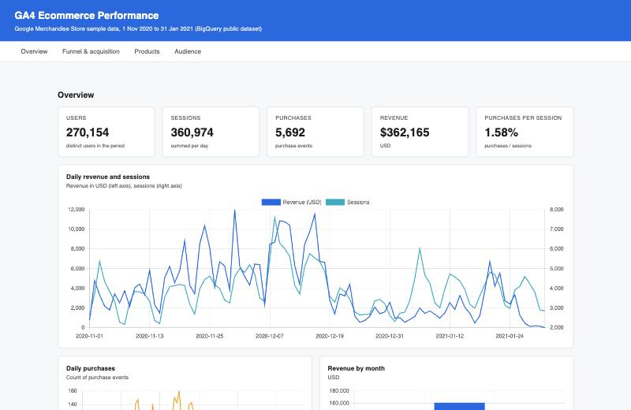
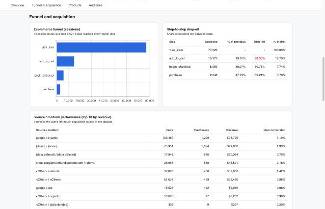
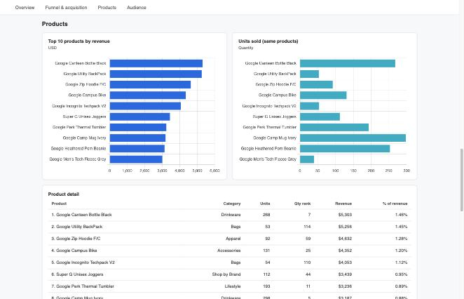
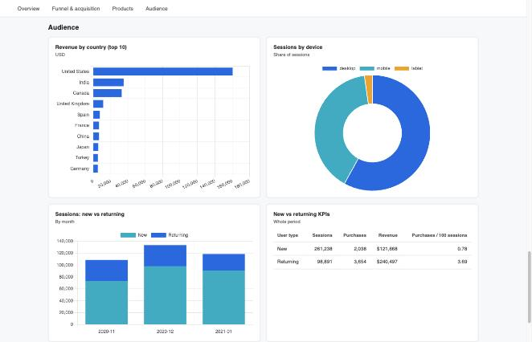

# GA4 Ecommerce Analytics: BigQuery + Looker Studio

> End-to-end analysis of 92 days of Google Merchandise Store GA4 event data: SQL in BigQuery, a four-page Looker Studio dashboard, and business recommendations.

**Live dashboard:** https://jadhaidar2007.github.io/ga4-ecommerce-bigquery-analysis/dashboard/

## Business problem

An online store wants to know where its revenue comes from and where it leaks. Specifically:

1. How are traffic, sessions, purchases and revenue trending day to day?
2. Which acquisition channels bring users who actually buy?
3. Where in the funnel (`view_item` → `add_to_cart` → `begin_checkout` → `purchase`) do most sessions drop off?
4. Which products drive revenue, and how do new and returning users differ?
5. Do device and country change conversion?

## Dataset

[`bigquery-public-data.ga4_obfuscated_sample_ecommerce.events_*`](https://developers.google.com/analytics/bigquery/web-ecommerce-demo-dataset): obfuscated GA4 export from the Google Merchandise Store, **1 Nov 2020 to 31 Jan 2021** (92 daily tables). Event-level rows with nested `event_params` and `items` arrays.

Known limits of the sample (stated up front so results are read correctly):
- `traffic_source.*` is the user's first-touch source, not per-session attribution.
- Some fields are obfuscated (`<Other>`, `(not set)`).
- It is a sample from one store, so findings illustrate method, not a general benchmark.

## Tools

BigQuery (sandbox, no billing) · BigQuery Standard SQL · Chart.js (dashboard) · Git/GitHub

## Method

1. Queried the public dataset with date-sharded wildcard tables and a `_TABLE_SUFFIX` filter to keep every query inside sandbox limits.
2. Flattened nested data with `UNNEST` (event parameters for `ga_session_id` / `ga_session_number`, and `items` for product revenue).
3. Defined a session as `user_pseudo_id` + `ga_session_id`, and built a session-based funnel where a session counts at a step only if it reached all earlier steps.
4. Materialised six small summary tables (`sql/07_dashboard_summary.sql`) so Looker Studio reads kilobytes instead of rescanning raw events.
5. Built the dashboard on those tables and wrote recommendations from the results.

| File | What it answers |
|---|---|
| [`sql/01_daily_kpis.sql`](sql/01_daily_kpis.sql) | Daily users, new users, sessions, purchases, revenue |
| [`sql/02_traffic_source_medium.sql`](sql/02_traffic_source_medium.sql) | Source / medium performance and conversion |
| [`sql/03_funnel.sql`](sql/03_funnel.sql) | Four-step funnel with step-to-step drop-off |
| [`sql/04_top_products.sql`](sql/04_top_products.sql) | Top 10 products by revenue and units |
| [`sql/05_new_vs_returning.sql`](sql/05_new_vs_returning.sql) | New vs returning users by month |
| [`sql/06_device_country.sql`](sql/06_device_country.sql) | Device and country breakdown |
| [`sql/07_dashboard_summary.sql`](sql/07_dashboard_summary.sql) | Builds all dashboard tables in one run |

## Key findings

Numbers below come straight from the BigQuery tables built by `sql/07_dashboard_summary.sql` (1 Nov 2020 to 31 Jan 2021).

- **Overall:** 270,154 users, about 361K daily-summed sessions, 5,692 purchase events and $362,165 revenue. Purchase sessions are roughly 1.3% of sessions.
- **Funnel (sessions):** 77,020 viewed an item, 15,173 added to cart (19.7%), 5,959 began checkout (39.3% of carts) and 2,848 purchased (47.8% of checkouts). The biggest leak is view_item → add_to_cart, where 80.3% drop off. Only 3.7% of item-view sessions complete the full funnel.
- **Acquisition:** google / organic brought the most revenue ($95,775 from 103,487 users, 1.19% user conversion), followed by (direct) / (none) at $79,650 (1.39%). Among the top four by revenue, shop.googlemerchandisestore.com / referral converted best at 2.18% (the "(data deleted)" bucket shows 3.79% but is an obfuscation artifact).
- **Products:** the top 10 products make up only 10.9% of revenue, so revenue is spread out. Google Canteen Bottle Black led with $5,303 (268 units), just ahead of Google Utility BackPack at $5,256 (53 units).
- **Audience:** returning-user sessions produced $240,497 vs $121,668 for new-user sessions, about 3.7 purchases per 100 sessions vs 0.8 for new. Device rates are similar: mobile 1.64, desktop 1.54 and tablet 1.39 purchases per 100 sessions.
- **Geography:** the United States led with $160,573 (44% of revenue), then India ($34,986) and Canada ($32,799).

**Data-quality notes:** revenue drops to almost nothing from 26 Jan 2021 although purchase events continue, so the end of the revenue trend looks incomplete in the source. Also, the 5,692 purchase events include 4,452 distinct transaction IDs and 906 events with no usable transaction ID, so "purchases" here counts events and may slightly overstate orders. "Sessions" are summed per day, so a session crossing midnight is counted on both days.

## Recommendations

1. **Fix the biggest leak first.** 80% of sessions that view a product never add it to the cart. Test clearer prices, shipping and returns info, and size/colour selection on product pages, and track the view_item → add_to_cart rate.
2. **Recover abandoned carts.** Only 39% of carts reach checkout and 48% of checkouts finish. A saved-cart reminder and fewer checkout fields are the cheapest things to try first.
3. **Invest in returning users.** Returning sessions are about a quarter of traffic but produced roughly two thirds of revenue ($240K of $362K) and convert at about 3.7 purchases per 100 sessions vs 0.8 for new users. Email and remarketing should help more than extra top-of-funnel spend.
4. **Review paid search.** google / cpc brought 15,527 users but only $9,056 in revenue (0.98% conversion), below organic and direct. Check keyword and landing-page quality before adding budget.
5. **Treat mobile as a full channel.** Mobile is 40% of sessions and converts about as well as desktop (1.64 vs 1.54 purchases per 100 sessions), so it deserves equal testing effort.

Caveats: this is one store over three months, source is first-touch, and revenue is incomplete in the last days of January.

## Dashboard

A one-page dashboard with four sections (Overview, Funnel & acquisition, Products, Audience), built with Chart.js on top of the BigQuery output. The data comes from the `ga4_portfolio.dash_*` tables and is saved in [`dashboard/data.json`](dashboard/data.json); the page is [`dashboard/index.html`](dashboard/index.html).

I first tried Looker Studio, but Google returned an authorization error (`invalid_scope`) on the Data Studio API for my account, so I built the page by hand instead. If you prefer Looker Studio, the layout is described in [`docs/02_looker_studio_build.md`](docs/02_looker_studio_build.md).

## Screenshots

| Overview | Funnel & Acquisition |
|---|---|
|  |  |

| Products | Audience |
|---|---|
|  |  |

## Skills demonstrated

- BigQuery Standard SQL: CTEs, window functions (`LAG`, `FIRST_VALUE`, `RANK`), `UNNEST` of nested/repeated fields, wildcard tables with `_TABLE_SUFFIX`, scripting (`CREATE SCHEMA`, `CREATE OR REPLACE TABLE`)
- GA4 event data model: sessions, events, parameters, ecommerce items
- Cost-aware querying in the BigQuery sandbox
- Funnel and cohort-style analysis, KPI definition
- Dashboard design (HTML, CSS, Chart.js) and turning data into recommendations

## Reproduce it

1. Enable the BigQuery sandbox: [`docs/01_bigquery_setup.md`](docs/01_bigquery_setup.md)
2. Run `sql/07_dashboard_summary.sql` in the BigQuery editor (creates dataset `ga4_portfolio`).
3. Export the tables to `dashboard/data.json` (or point a Looker Studio report at them using [`docs/02_looker_studio_build.md`](docs/02_looker_studio_build.md)).

Sandbox tables expire after 60 days; re-run step 2 to refresh them.

## Next steps

- Add per-session attribution using `collected_traffic_source` on newer GA4 exports.
- Add a product-category view and a basket-size analysis.
- Add a cohort retention view (week-of-first-visit vs return weeks).
- Schedule `07_dashboard_summary.sql` as a BigQuery scheduled query.
- Test funnel drop-off by device and recommend an A/B test for the weakest step.

## Author

Jad Haidar · Industrial Engineering & Management (Data Science minor), Constructor University · [GitHub](https://github.com/jadhaidar2007)
